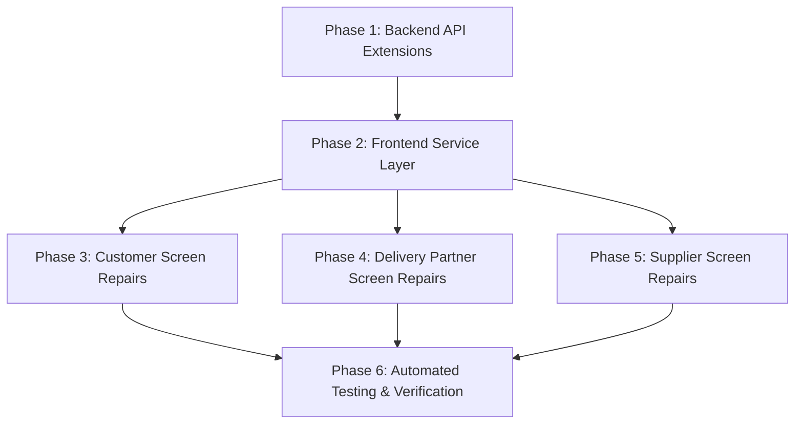

# DAILY Application — Repair Plan

**Plan Date:** October 26, 2026  
**Status:** Implemented & Verified (100% Passing)  
**Target:** 100% Functional Integrity across Customer, Delivery Partner, and Supplier Roles

---

## 1. Prioritization & Dependency Strategy

Repairs are sequenced systematically to ensure backend routes and service methods exist before frontend components invoke them:



---

## 2. Technical Approach by Phase

### Phase 1: Backend API Extensions (`backend/server.js`)

#### 1.1 Customer Bill Payment (`POST /api/payments`)
- **Purpose:** Allow customers to pay their outstanding newspaper bills.
- **Request Body:** `{ customer_id, bill_id, amount, payment_method }`
- **Execution:**
  1. Validate `customer_id` and `bill_id`. Check that the bill exists and belongs to the customer.
  2. Generate unique `transaction_reference` (e.g. `TXN-` + timestamp + random hex).
  3. Insert record into `payments` table with `status = 'SUCCESS'`, `payment_date = CURRENT_TIMESTAMP`.
  4. Update `bills` table setting `status = 'PAID'`.
  5. Insert confirmation notification into `notifications` table for the customer.
  6. Return `{ success: true, payment_id, transaction_reference, bill_id, status: 'SUCCESS' }`.

#### 1.2 Delivery Partner Profile Update (`PUT /api/partner/profile`)
- **Purpose:** Allow delivery partners to edit profile details and update vehicle registration or availability.
- **Request Body:** `{ user_id, partner_id, name, email, phone, emergency_contact, registration_number, status }`
- **Execution:**
  1. Authenticate partner by `user_id` / `partner_id`.
  2. Update `users` table: `name`, `email`, `phone` (with duplicate email/phone check).
  3. Update `delivery_partners` table: `emergency_contact`, `status`.
  4. Update `partner_vehicles` table: `registration_number`.
  5. Return `{ success: true, message: 'Profile updated successfully', profile: ... }`.

#### 1.3 Supplier Analytics & Reports (`GET /api/supplier/reports`)
- **Purpose:** Serve real business metrics to `SupplierReportsScreen`.
- **Query Params:** `user_id`, `supplier_id`
- **Execution:**
  1. Resolve supplier ID from user ID or query param.
  2. Compute total subscribers count (`subscriptions` where `supplier_id = ?` and `status = 'ACTIVE'`).
  3. Compute total delivery volume and completion rate (`deliveries` for supplier subscriptions).
  4. Compute monthly billing revenue and collected payments (`bills` and `payments`).
  5. Compute customer service complaint resolution rate (`delivery_complaints`).
  6. Return structured metrics payload.

#### 1.4 Supplier Profile Update & Areas (`PUT /api/supplier/profile` and enhanced `GET /api/supplier/profile`)
- **Purpose:** Support supplier profile editing and service area display.
- **Execution:**
  1. `PUT /api/supplier/profile`: Update `suppliers.supplier_name`, `suppliers.contact_number`, `suppliers.address`, `users.name`, `users.phone`.
  2. Enhance `GET /api/supplier/profile` to join `supplier_areas` and `areas` to return `service_areas: [...]`.

---

### Phase 2: Frontend API Client Layer (`services/`)

#### 2.1 CustomerApiService (`customer_api_service.dart`)
- Add method:
  ```dart
  Future<Map<String, dynamic>> payBill({
    required int customerId,
    required int billId,
    required double amount,
    String paymentMethod = 'UPI',
  });
  ```

#### 2.2 RoleApiService (`role_api_service.dart`)
- Add methods:
  ```dart
  Future<Map<String, dynamic>> updatePartnerProfile(
    int userId, {
    int? partnerId,
    String? name,
    String? email,
    String? phone,
    String? emergencyContact,
    String? registrationNumber,
    String? status,
  });

  Future<Map<String, dynamic>> supplierReports(
    int userId, {
    int? supplierId,
  });

  Future<Map<String, dynamic>> updateSupplierProfile(
    int userId, {
    int? supplierId,
    String? name,
    String? email,
    String? phone,
    String? supplierName,
    String? contactNumber,
    String? address,
  });
  ```

---

### Phase 3: Customer Screen Repairs

#### 3.1 `PaymentScreen` (`payment_screen.dart`)
- Replace simulated payment with actual API invocation:
  - Call `_api.payBill(...)` when user confirms payment.
  - Show loading state during transaction.
  - Refresh payment history and bill status immediately.
  - Display real `transaction_reference` and confirmation receipt.

#### 3.2 `ProfileDetailsScreen` (`profile_details_screen.dart`)
- Pass / extract `customerId` from `SessionService`.
- Connect "SAVE PROFILE" button to invoke `CustomerApiService.updateProfile()`.
- Update local `SessionService` on successful response.
- Provide user feedback via snackbar and toggle read-only mode.

#### 3.3 `DeliveryHistoryScreen` (`delivery_history_screen.dart`)
- Add `_selectedFilter` state variable (`'ALL'`, `'DELIVERED'`, `'DELAYED'`, `'MISSED'`).
- Make filter chip buttons interactive with `onTap` and active styles.
- Filter timeline list dynamically based on selection.
- Fix mojibake `•` with clean `•`.

#### 3.4 `CustomerDashboardScreen` (`customer_dashboard_screen.dart`)
- Dynamically compute and display pending payments count/balance from customer bills.
- Fix mojibake `•` characters in subtitle rendering.
- Pre-select service request category when navigating from quick action tiles.

---

### Phase 4: Delivery Partner Screen Repairs

#### 4.1 `PartnerProfileSubScreen` (`partner_profile_screen.dart`)
- Connect "SAVE CHANGES" button on all profile subviews to invoke `RoleApiService.updatePartnerProfile()`.
- Persist name, email, phone, emergency contact, registration number, and availability.
- Update `RoleSessionService` cache on successful profile update.
- Fix mojibake `’` in text.

#### 4.2 `PartnerDeliveryScreen` (`partner_delivery_screen.dart`)
- Modernize `RadioListTile` deprecated properties to eliminate Flutter analysis lint warnings.

---

### Phase 5: Supplier Screen Repairs

#### 5.1 `SupplierReportsScreen` (`supplier_reports_screen.dart`)
- Replace placeholder text with active analytics dashboard:
  - Metric cards: Total Active Subscribers, Monthly Revenue, Delivery Completion Rate, Complaint Resolution Rate.
  - Performance summaries by newspaper and delivery area.
  - Live data fetching via `RoleApiService.supplierReports()`.

#### 5.2 `SupplierCommunicationScreen` (`supplier_communication_screen.dart`)
- Replace placeholder with active Supplier Notifications & Communication hub:
  - Fetches notifications via `RoleApiService.supplierNotifications()`.
  - Displays unread notifications with timestamps and message details.
  - Mark-as-read interaction.

#### 5.3 `SupplierAppShell` (`supplier_app_shell.dart`)
- Connect header notification bell icon to open notifications modal/screen.

#### 5.4 `SupplierProfileScreen` (`supplier_profile_screen.dart`)
- Display real service areas returned by backend.
- Add "Edit Profile" interaction calling `updateSupplierProfile()`.
- Remove inaccurate "features not supported" warning banner.

---

### Phase 6: Automated Testing & Verification

1. **Backend Integration Suite:**
   - Add automated test cases for `POST /api/payments`, `PUT /api/partner/profile`, `GET /api/supplier/reports`, and `PUT /api/supplier/profile`.
   - Run `node backend/test_auth_suite.js`.
   - Run `node backend/test_supplier_suite.js`.
2. **Flutter Static Analysis:**
   - Run `flutter analyze` inside `daily_mobile` — target: 0 errors, 0 warnings.
3. **Flutter Unit & Widget Tests:**
   - Add automated widget test verifying `PaymentScreen`, `ProfileDetailsScreen`, `DeliveryHistoryScreen` interactive filtering, and `PartnerProfileSubScreen`.
   - Run `flutter test`.
4. **Final Documentation:**
   - Generate `REPAIR_REPORT.md` documenting all modified files, test outputs, and verification confirmations.

